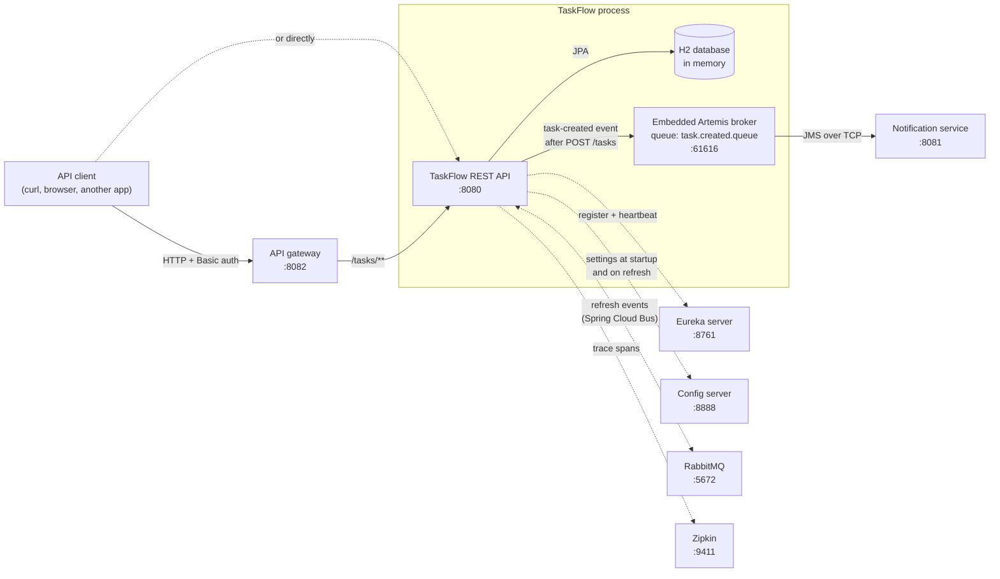

# TaskFlow

TaskFlow is a REST API for managing a to-do list, built with Spring Boot. You can create, list, filter, view, update and delete tasks. Each task has a title and a done/not-done status.

- Anyone can read tasks. Creating and updating tasks requires a login, and deleting requires an admin login.
- Each time a task is created, TaskFlow publishes a `task-created` event to a JMS message queue that other services can listen to.
- TaskFlow registers itself with a Eureka server so other services can discover it.
- Shared settings come from a Spring Cloud Config server, and some of them can be changed while TaskFlow is running, without a restart.
- Every request gets a correlation ID that appears in the logs and travels with the task-created event.

Tasks and users are stored in an in-memory H2 database, so **all data is lost when the application stops**.

## How TaskFlow talks to other services



- **H2** and the **Artemis broker** run inside the TaskFlow process, so nothing else needs to be installed for them.
- The broker also listens on TCP port **61616**, so other services can connect to it and read from `task.created.queue`.
- Everything outside the TaskFlow box is a separate application that isn't part of this repository. The API gateway, notification service, Eureka server and config server each have their own project. RabbitMQ and Zipkin are installed separately.
- The **config server** is the only one TaskFlow can't start without. See [Running without the other services](#running-without-the-other-services).

## Tech stack

- Java 25
- Spring Boot 4.1 (Web MVC, Data JPA, Validation, Security, Artemis/JMS, Actuator)
- Spring Cloud 2025.1 (Netflix Eureka client, Config client, Bus over AMQP)
- Micrometer Tracing with a Zipkin exporter
- Apache Artemis 2.53, embedded message broker
- H2 in-memory database
- Maven (the wrapper is included, so you don't need to install Maven)

## Getting started

### Prerequisites

- JDK 25 or newer
- Ports **8080** (API) and **61616** (message broker) must be free.
- The **config server** running at `http://localhost:8888`. TaskFlow fails to start without it.
- Optional: the Eureka server (`:8761`), RabbitMQ (`:5672`) and Zipkin (`:9411`). TaskFlow runs without them, but logs connection errors.

### Run the application

Start the config server first, then:

```bash
# macOS / Linux / WSL
./mvnw spring-boot:run

# Windows
mvnw.cmd spring-boot:run
```

The API starts at `http://localhost:8080`.

### Run everything with Docker

TaskFlow has a two-stage `Dockerfile`: it builds the jar with JDK 25 and runs it on a JRE 25 image that includes `curl` for health checks. Tests are skipped during the image build.

To run TaskFlow together with all the other services and RabbitMQ, use the Compose setup in the sibling `taskflow-compose` folder:

```bash
cd ../taskflow-compose
docker compose up -d --build
```

Compose starts the services in dependency order and points TaskFlow at the containers by name (`config-server`, `discovery-server`, `rabbitmq`) through environment variables. See `taskflow-compose/README.md` for details.

### Run the tests

```bash
./mvnw test        # or mvnw.cmd test on Windows
```

| Test class                 | What it tests                                                                             |
|----------------------------|-------------------------------------------------------------------------------------------|
| `TaskControllerTest`       | Endpoints, validation, error bodies and security rules, with `TaskService` mocked          |
| `TaskRepositoryTest`       | Saving tasks and filtering by `done`, against a real in-memory database                    |
| `NotificationClientTest`   | Events go to the right queue, and a broker failure doesn't break task creation             |
| `TaskflowApplicationTests` | The whole application starts                                                               |

## Authentication

TaskFlow uses **HTTP Basic** authentication. Send a username and password with each request that needs one, for example `curl -u alice:alicepass`.

These accounts are created when the app starts:

| Username | Password    | Role    |
|----------|-------------|---------|
| `admin`  | `adminpass` | `ADMIN` |
| `alice`  | `alicepass` | `USER`  |

> These passwords are for local development only. They are set in `DataSeeder.java`.

| Request                                                     | Who can do it            |
|-------------------------------------------------------------|--------------------------|
| `GET /tasks`, `GET /tasks/{id}`                             | Anyone, no login needed  |
| `POST /tasks`, `PUT /tasks/{id}`                            | Any logged-in user       |
| `DELETE /tasks/{id}`                                        | `ADMIN` only             |
| Everything else (including `/actuator/*`, `/internal/*` and the H2 console) | Any logged-in user |

No login or a wrong password returns `401 Unauthorized`. Being logged in without permission, for example `alice` deleting a task, returns `403 Forbidden`.

## API

All requests and responses use JSON.

### Task object

```json
{
  "id": 1,
  "title": "Buy groceries",
  "done": false
}
```

### Endpoints

| Method   | Path                | Login    | Description                | Success       | Errors              |
|----------|---------------------|----------|----------------------------|---------------|---------------------|
| `GET`    | `/tasks`            | —        | List all tasks             | `200` + array | —                   |
| `GET`    | `/tasks?done=true`  | —        | List only done tasks       | `200` + array | —                   |
| `GET`    | `/tasks?done=false` | —        | List only unfinished tasks | `200` + array | —                   |
| `POST`   | `/tasks`            | Any user | Create a task              | `200` + task  | `400`, `401`        |
| `GET`    | `/tasks/{id}`       | —        | Get one task               | `200` + task  | `404`               |
| `PUT`    | `/tasks/{id}`       | Any user | Update a task              | `200` + task  | `400`, `401`, `404` |
| `DELETE` | `/tasks/{id}`       | Admin    | Delete a task              | `204` no body | `401`, `403`, `404` |

For the configuration endpoints (`/actuator/refresh`, `/actuator/busrefresh` and `/internal/sampling-probability`), see [Changing settings without a restart](#changing-settings-without-a-restart).

### Request bodies

**Create** (`POST /tasks`). New tasks always start as not done.

```json
{ "title": "Buy groceries" }
```

**Update** (`PUT /tasks/{id}`). This replaces both fields, so send both. `done` is required. Leaving it out returns `400`.

```json
{ "title": "Buy groceries", "done": true }
```

In both requests, `title` is required and must not be blank.

### Error responses

A missing task (`404`) or a blank title (`400`) returns this format:

```json
{
  "timestamp": "2026-10-28T10:15:10.342Z",
  "status": 404,
  "message": "Task 99 not found"
}
```

For a blank title, `message` is `title must not be blank`. Other errors, such as invalid JSON or a missing `done` field, use Spring Boot's default error format. That format has `error` and `path` fields instead of `message`.

### Example with curl

```bash
# List tasks (no login needed)
curl http://localhost:8080/tasks

# List only unfinished tasks
curl "http://localhost:8080/tasks?done=false"

# Create a task
curl -u alice:alicepass -X POST http://localhost:8080/tasks \
  -H "Content-Type: application/json" \
  -d '{"title": "Buy groceries"}'

# Mark task 1 as done
curl -u alice:alicepass -X PUT http://localhost:8080/tasks/1 \
  -H "Content-Type: application/json" \
  -d '{"title": "Buy groceries", "done": true}'

# Delete task 1 (admin only)
curl -u admin:adminpass -X DELETE http://localhost:8080/tasks/1
```

On Windows PowerShell, use `curl.exe`, put each command on one line, and escape the inner quotes, for example `-d '{\"title\": \"Buy groceries\"}'`.

## Correlation IDs

Every request gets a correlation ID so you can follow it through the logs of TaskFlow and the services it talks to:

- If the request has an `X-Correlation-Id` header, TaskFlow uses that value. The API gateway adds one to every request it forwards. Otherwise TaskFlow generates a random UUID.
- TaskFlow sends the ID back in the response's `X-Correlation-Id` header.
- The ID appears in every log line written while the request is handled, for example `INFO [3f1c9a2e-...]`. The log format comes from the shared setting `logging.pattern.level` on the config server.
- The ID is attached to the task-created event, so the notification service can log the same ID. See [Task-created events](#task-created-events).

```bash
curl -i -H "X-Correlation-Id: demo-123" http://localhost:8080/tasks
# Response includes: X-Correlation-Id: demo-123
```

This is done by `CorrelationIdFilter`. It runs after Spring Security, so a request rejected with `401` or `403` gets no correlation ID and no `X-Correlation-Id` response header.

## Task-created events

After a task is saved, TaskFlow sends a message to the queue **`task.created.queue`** on the embedded Artemis broker. The message is a JMS text message:

- **Body** (JSON):
  ```json
  { "taskId": 1, "title": "Buy groceries" }
  ```
- **Property** `_type` = `task-created`, which tells consumers what kind of event it is.
- **Property** `correlationId`, the correlation ID of the request that created the task.

To receive events, another service connects to the broker at `tcp://localhost:61616` and listens on `task.created.queue`.

If the event can't be sent, TaskFlow logs a warning (`Failed to publish task-created event ...`) and the request still succeeds. The task is saved either way.

## Service discovery (Eureka)

On startup, TaskFlow registers with a Eureka server at `http://localhost:8761/eureka/` under the name `TASKFLOW`, then sends a heartbeat every 30 seconds. Other services can then look up TaskFlow by name instead of hard-coding its address. For example, the API gateway forwards `/tasks/**` to `lb://TASKFLOW`.

The Eureka address is a shared setting that comes from the config server.

## Configuration

TaskFlow's settings come from two places.

**Local settings**, in `src/main/resources/application.properties`:

| Property                                  | Value                                         | Purpose                                         |
|-------------------------------------------|-----------------------------------------------|-------------------------------------------------|
| `spring.datasource.url`                   | `jdbc:h2:mem:taskflow`                        | In-memory database                              |
| `spring.h2.console.enabled`               | `true`                                        | H2 web console at `/h2-console`                 |
| `spring.artemis.mode`                     | `embedded`                                    | Run the message broker inside TaskFlow          |
| `spring.artemis.embedded.queues`          | `task.created.queue`                          | Create the event queue at startup               |
| `spring.config.import`                    | `optional:configserver:http://localhost:8888` | Load shared settings from the config server     |
| `management.endpoints.web.exposure.include` | `refresh,busrefresh`                        | Make the two refresh endpoints reachable over HTTP |

**Shared settings**, served by the config server from its `config/application.properties`. Every service that uses the config server gets these:

| Property                                  | Example value                     | Purpose                                      |
|-------------------------------------------|-----------------------------------|----------------------------------------------|
| `eureka.client.service-url.defaultZone`   | `http://localhost:8761/eureka/`   | Where the Eureka server is                   |
| `eureka.instance.hostname`                | `localhost`                       | Address TaskFlow registers with              |
| `logging.pattern.level`                   | `%5p [%X{correlationId:-}]`       | Adds the correlation ID to each log line     |
| `management.tracing.sampling.probability` | `0.5`                             | Share of requests that are traced to Zipkin  |

Settings from the config server take priority over local ones with the same name. To give TaskFlow its own value for a shared setting, add a `taskflow.properties` file next to the shared one on the config server.

The broker's TCP port (61616) is set in `JmsConfig.java`.

## Changing settings without a restart

Beans marked with `@RefreshScope` re-read their settings when a refresh is triggered. `ConfigProbeController` is one of these. It shows the current value of `management.tracing.sampling.probability`, so you can see a refresh take effect.

| Method | Path                              | What it does                                                                    |
|--------|-----------------------------------|---------------------------------------------------------------------------------|
| `GET`  | `/internal/sampling-probability`  | Returns the current sampling probability, for example `0.5`                     |
| `POST` | `/actuator/refresh`               | Reloads settings from the config server, in this TaskFlow instance only         |
| `POST` | `/actuator/busrefresh`            | Reloads settings in every service connected to the bus, through RabbitMQ        |

All three need a login.

To try it:

```bash
# 1. Check the current value
curl -u admin:adminpass http://localhost:8080/internal/sampling-probability

# 2. Change management.tracing.sampling.probability in the config server's
#    config/application.properties, then confirm the config server serves the new value
curl http://localhost:8888/taskflow/default

# 3. Tell TaskFlow to reload
curl -u admin:adminpass -X POST http://localhost:8080/actuator/refresh
# ["management.tracing.sampling.probability"]

# 4. Check again: the new value, with no restart
curl -u admin:adminpass http://localhost:8080/internal/sampling-probability
```

`/actuator/refresh` returns the names of the settings that changed. An empty list, `[]`, means the config server is serving the same values as before.

Use `/actuator/busrefresh` instead to refresh all services at once. It needs RabbitMQ, and only services that have `spring-cloud-starter-bus-amqp` receive the refresh.

## Running without the other services

| Missing service      | What happens                                                                                                  |
|----------------------|---------------------------------------------------------------------------------------------------------------|
| Config server        | **TaskFlow doesn't start.** `ConfigProbeController` needs `management.tracing.sampling.probability`, which only the config server provides, so startup fails with `Could not resolve placeholder`. |
| Eureka server        | `Connection refused ... localhost:8761` stack traces in the log every 30 seconds. The API works normally.      |
| RabbitMQ             | Connection errors in the log. The API and `/actuator/refresh` work. `/actuator/busrefresh` doesn't.           |
| Zipkin               | Warnings in the log when trace data can't be sent. The API works normally.                                     |
| Event consumer       | Events stay on `task.created.queue` until something reads them. They're lost when the app stops.              |

To hide the Eureka errors while you develop without a Eureka server, add this to `application.properties`:

```properties
eureka.client.enabled=false
```

## Known issues

- **TaskFlow can't start without the config server**, even though the import is marked `optional:`. Giving the probe setting a default, such as `@Value("${management.tracing.sampling.probability:0.1}")`, would let it start on local settings alone.
- **Any logged-in user can trigger a refresh.** `/actuator/*` falls under "any logged-in user", so `alice` can call `/actuator/refresh` and `/actuator/busrefresh`. Restricting `/actuator/**` to `ADMIN` would fix this.
- **The H2 console doesn't work in a browser.** `/h2-console` requires a TaskFlow login. Even after you log in, Spring Security's default `X-Frame-Options: DENY` header stops the console's page frames from loading. Using it would need a security rule that allows `/h2-console/**` and same-origin frames. The connection details are JDBC URL `jdbc:h2:mem:taskflow`, user `sa`, and an empty password.
- **Undelivered events are lost when the app stops.** The broker is embedded, so it stops with TaskFlow.

## Project structure

```
Dockerfile                                # Two-stage image build (JDK 25 build, JRE 25 runtime)
src/main/java/com/taskflow/
├── TaskflowApplication.java              # Application entry point
├── controller/TaskController.java        # REST endpoints
├── service/TaskService.java              # Business logic; publishes an event after create
├── client/
│   ├── NotificationClient.java           # Sends task-created events (with correlation ID) to the JMS queue
│   └── TaskCreatedEvent.java             # Event payload (taskId, title)
├── filter/CorrelationIdFilter.java       # Reads or creates X-Correlation-Id and puts it in the logs
├── repository/
│   ├── TaskRepository.java               # Task storage, including findByDone
│   └── UserRepository.java               # User lookup by username
├── model/
│   ├── Task.java                         # Task entity
│   └── AppUser.java                      # User entity (username, password hash, role)
├── dto/
│   ├── CreateTaskRequest.java            # POST body (with validation)
│   ├── UpdateTaskRequest.java            # PUT body (with validation)
│   └── ErrorResponse.java                # JSON error body
├── exception/
│   ├── TaskNotFoundException.java        # Thrown when a task id doesn't exist
│   └── GlobalExceptionHandler.java       # Turns exceptions into 404/400 error bodies
└── config/
    ├── SecurityConfig.java               # Access rules, HTTP Basic, password hashing
    ├── TaskFlowUserDetailsService.java   # Loads users from the database for login
    ├── DataSeeder.java                   # Creates the admin and alice accounts at startup
    ├── JmsConfig.java                    # JSON message format and broker TCP port
    └── ConfigProbeController.java        # Shows a refreshable setting at /internal/sampling-probability
```

A request goes through Spring Security first, which checks the login and the access rules. `CorrelationIdFilter` then sets its correlation ID. The request goes from the controller to the service, and from the service to the repository, which reads and writes the database. After a task is created, the service calls `NotificationClient`, which publishes the event to the queue. Errors are turned into JSON responses by `GlobalExceptionHandler`. Passwords are stored as BCrypt hashes, never as plain text.
